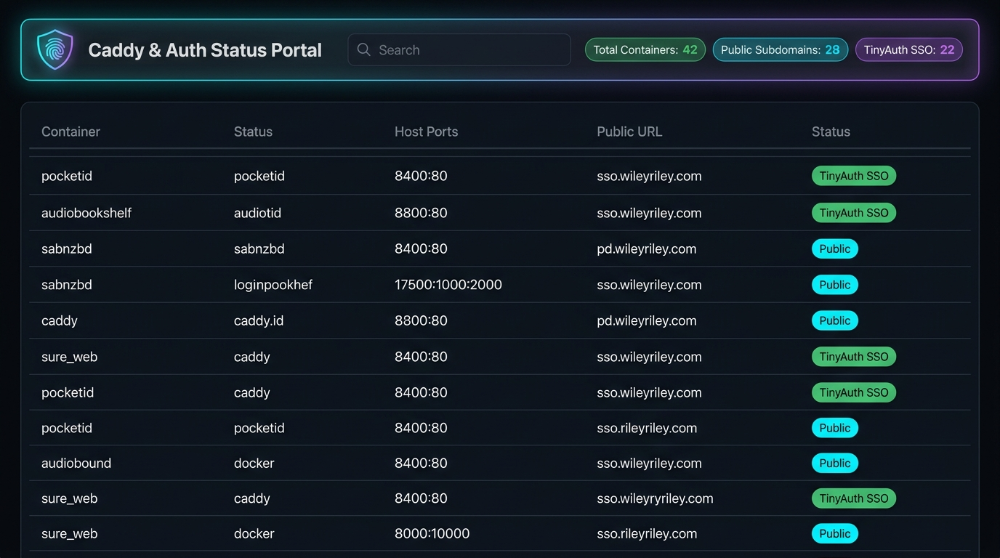

# 🛡️ Caddy & Auth Status Portal (`dockerCaddyStatusPortal`)

[](https://github.com/spelech/dockerCaddyStatusPortal/actions/workflows/docker-build.yml)
[](https://github.com/spelech/dockerCaddyStatusPortal/pkgs/container/dockercaddystatusportal)
[](https://opensource.org/licenses/MIT)

A lightweight, real-time status and security audit portal for Docker Compose homelabs, **Caddy reverse proxy** routes, and **TinyAuth / PocketID** Single Sign-On (SSO) protection.



---

## ✨ Features

- **🔍 Automatic Docker Compose Discovery**: Scans all `docker-compose.yaml` files across multi-stack directory trees.
- **🌐 Caddy Subdomain Routing Audit**: Extracts public (`caddy`) and LAN (`caddy_*`) reverse proxy routes automatically.
- **🔐 TinyAuth / PocketID SSO Verification**: Audits forward-auth protection across all services, highlighting which endpoints are publicly exposed vs SSO-protected.
- **🔌 Port & Network Mapping**: Displays host-to-container port bindings, host-networking modes, and Docker networks.
- **⚡ Dynamic Search & Multi-Column Filtering**: Instant filtering by stack name, container status, SSO status (Yes/No), and text queries.
- **🛡️ Safe & Zero-Leak Parsing**: Only reads Compose service definitions; ignores credentials, secrets, and environment variable values.
- **🚀 Zero-Dependency Backend**: Built on standard Python `http.server` with a reactive vanilla HTML5/JS glassmorphism dashboard.

---

## ⚡ Quickstart

### 1. Run with Docker Compose

Add the service to your Docker Compose stack:

```yaml
services:
  caddy-auth-portal:
    container_name: caddy-auth-portal
    image: ghcr.io/spelech/dockercaddystatusportal:latest
    restart: unless-stopped
    ports:
      - "8040:8040"
    volumes:
      - /path/to/your/containers:/containers:ro
    environment:
      - PORT=8040
      - BASE_DIR=/containers
```

### 2. Run with Docker CLI

```bash
docker run -d \
  --name caddy-auth-portal \
  -p 8040:8040 \
  -v /containers:/containers:ro \
  -e PORT=8040 \
  -e BASE_DIR=/containers \
  ghcr.io/spelech/dockercaddystatusportal:latest
```

---

## ⚙️ Environment Variables

| Variable | Default | Description |
| :--- | :--- | :--- |
| `PORT` | `8040` | Port for the HTTP server to listen on. |
| `BASE_DIR` | `/containers` | Base directory containing Docker Compose stack subdirectories. |

---

## 📡 REST API Endpoints

- **`GET /api/containers`**: Returns the parsed JSON catalog of all discovered containers, ports, networks, subdomains, and auth statuses.
- **`GET /api/refresh`**: Re-scans all `docker-compose.yaml` files on disk and returns updated container state.

---

## 🔒 Security & Secret Safety

The portal is designed strictly as a **read-only structural analyzer**:
- Never parses or exposes `.env` files or secret values.
- Strictly parses Compose file metadata (images, published ports, network names, labels).
- Mounts `/containers` in **Read-Only (`:ro`)** mode.

---

## 🏷️ Semantic Versioning & Builds

Automated GitHub Actions workflow builds multi-architecture images (`linux/amd64`, `linux/arm64`) on every release tag (`v1.0.0`, `v1.0`, etc.) and `main` branch push.

---

## 📄 License

[MIT License](LICENSE)
